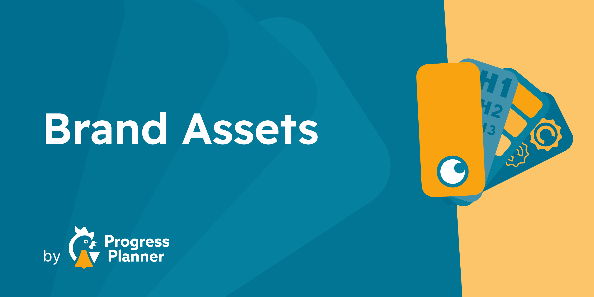

[](https://github.com/ProgressPlanner/brand-assets/actions/workflows/cs.yml)
[](https://github.com/ProgressPlanner/brand-assets/actions/workflows/phpstan.yml)
[](https://github.com/ProgressPlanner/brand-assets/actions/workflows/security.yml)

[](https://wordpress.org/plugins/brand-assets/)

[](https://wordpress.org/plugins/brand-assets/advanced/)
[](https://wordpress.org/plugins/brand-assets/advanced/)
[](https://wordpress.org/support/plugin/brand-assets/reviews/)
[](https://github.com/ProgressPlanner/brand-assets/blob/main/LICENSE)

[](https://playground.wordpress.net/#ewoJImxhbmRpbmdQYWdlIjogIi93cC1hZG1pbi9vcHRpb25zLWdlbmVyYWwucGhwP3BhZ2U9YnJhbmQtYXNzZXRzLXNldHRpbmdzIiwKCSJsb2dpbiI6IHRydWUsCgkic3RlcHMiOiBbCgkJewoJCQkic3RlcCI6ICJpbnN0YWxsUGx1Z2luIiwKCQkJInBsdWdpbkRhdGEiOiB7CgkJCQkicmVzb3VyY2UiOiAidXJsIiwKCQkJCSJ1cmwiOiAiaHR0cHM6Ly9naXRodWItcHJveHkuY29tL3Byb3h5Lz9yZXBvPS9Qcm9ncmVzc1BsYW5uZXIvYnJhbmQtYXNzZXRzJmJyYW5jaD1tYWluIgoJCQl9CgkJfQoJXQp9)



# Brand Assets

Create a polished brand assets page in WordPress with reusable color palettes, downloadable files, and a logo popover that helps visitors find the right brand resources fast.

Brand Assets is a block-based WordPress plugin for teams that need a simple way to publish logos, colors, typography guidance, and downloadable brand files on their own site.

## Why Brand Assets?

Most teams keep brand files scattered across PDFs, cloud folders, and outdated guideline pages. Brand Assets helps you turn that mess into a clear, on-site brand hub your team, clients, partners, and press contacts can actually use.

Use it to:

- publish a public or internal brand guidelines page
- show approved brand colors with optional CMYK values
- add downloadable logo and asset links directly inside content
- guide visitors from your site logo to the correct brand assets page
- launch faster with a ready-made block pattern

## Core features

### Brand color palette block

Show brand colors in clean swatches with controls for:

- swatch width and height
- gaps between colors
- border width, radius, and color
- optional CMYK values for print workflows

### Logo popover

Add a contextual popover to your site logo so visitors can quickly jump to your brand assets page.

Visitors can right-click the logo or tab to the **Open brand assets** button and press Enter or Space. With the default styling, the button becomes visible when focused. Escape or **Close dialog** closes the dialog and returns focus to that button.

You can configure:

- target page
- heading and supporting text
- link text
- CSS selector for the logo element
- CSS loading mode for styling control

### Download-friendly brand pages

Place the cursor inside a text link and toggle **This link is a download** in the block toolbar. Brand Assets adds the `download` attribute to that link on the front end. This is useful for logo packs, PDFs, icon files, and brand guideline downloads.

### Ready-made brand page pattern

Start with a prebuilt pattern that includes:

- logo and icon sections
- downloadable asset links
- a sample brand color section
- typography examples

## Good fit for

- product teams publishing brand kits
- agencies handing off brand files to clients
- companies that want a public media kit page
- websites that need a simple brand guidelines page in Gutenberg

## Quick start

1. Install and activate **Brand Assets**.
2. Create or open the page that will hold your brand guidelines.
3. Insert the **Brand Assets** pattern or add the **Color Palette - Brand Assets** block.
4. Add your colors, logo downloads, and typography guidance.
5. In **Settings → Brand Assets**, connect your site logo to the page with the popover settings.

## Installation

### From the WordPress admin

1. Go to **Plugins → Add New**.
2. Search for **Brand Assets**.
3. Click **Install Now** and then **Activate**.

### Manual installation

1. Download the plugin files.
2. Upload them to `/wp-content/plugins/brand-assets/`.
3. Activate the plugin through the **Plugins** screen in WordPress.

## Usage

### Add the color palette block

1. Open the block editor.
2. Search for **Color Palette - Brand Assets**.
3. Add your hex color values.
4. Adjust spacing, sizing, borders, and optional CMYK output in the block sidebar.

### Configure the logo popover

1. Go to **Settings → Brand Assets**.
2. Select the page that should receive logo-click visitors.
3. Customize the heading, supporting text, and link label.
4. Set the logo CSS selector if you are not using the default site logo block.
5. Save your changes.

### Create download links

1. Add a text link in a paragraph, list item, or another rich-text block.
2. Place the cursor inside the link.
3. Toggle **This link is a download** in the block toolbar.

Only that link changes. You can edit its URL or text, save, and reopen the editor without losing the setting. Selecting part of a link still changes the entire link; selections spanning multiple links do not show the toggle.

The existing `ba-download` class on a list item continues to make its links downloadable:

```html
<ul>
  <li class="ba-download">
    <a href="https://example.com/files/brand-guidelines.pdf">Brand Guidelines (PDF)</a>
  </li>
  <li class="ba-download">
    <a href="https://example.com/files/logo-pack.zip">Logo Pack (ZIP)</a>
  </li>
</ul>
```

Links inside list items with the `ba-download` class will automatically receive the `download` attribute.

Turning the toggle off for a link inside such an item excludes that link from downloads. Existing custom classes, link targets, and relationships are preserved. Files hosted on another website may require download headers from that server; the toggle cannot force a browser to download every external URL.

## Settings overview

| Setting | What it does | Default |
| --- | --- | --- |
| Brand Assets Page | Selects the page the popover should link to | None |
| Popover Heading | Main popover heading | Looking for our logo? |
| Popover Text Line 1 | First supporting line | You're in the right spot! |
| Popover Text Line 2 | Text before the link | Check out our |
| Link Text | Link label shown inside the popover | brand assets |
| Logo Selector | CSS selector used to attach the popover | `.wp-block-site-logo` |
| CSS Loading Mode | Controls how popover CSS is loaded | Load the default CSS |

### Popover styling options

The settings page also lets you adjust:

- background, text, link, border, and close button colors
- border width and radius
- padding and max width
- font size

These are implemented with CSS custom properties, keeping customization flexible while staying WordPress.org-friendly.

## Developer hooks

### `brand_assets_frontend_css_path`

Filter the path to the frontend CSS file used for the logo popover.

```php
add_filter( 'brand_assets_frontend_css_path', function( $path ) {
    return get_stylesheet_directory() . '/custom-brand-assets.css';
} );
```

### `brand_assets_pattern_file_path`

Filter the path to the block pattern file used for the brand page template.

```php
add_filter( 'brand_assets_pattern_file_path', function( $path ) {
    return get_template_directory() . '/custom-brand-pattern.php';
} );
```

## Development

### Prerequisites

- WordPress 6.9+
- PHP 7.4+
- Node.js 18.12+
- npm
- a local WordPress development environment

### Setup

```bash
git clone https://github.com/ProgressPlanner/brand-assets.git
cd brand-assets
npm install
```

### Common commands

```bash
npm start                 # Start development build
npm test                  # Test individual download link controls
npm run build             # Build for production
npm run lint:js           # Lint JavaScript
npm run lint:css          # Lint CSS
npm run lint:php          # Run PHP_CodeSniffer
npm run lint:php:fix      # Auto-fix PHP coding standards issues
npm run lint:php:compatibility # Check PHP compatibility
composer phpstan          # Run PHPStan
```

## Support

- Plugin page: https://wordpress.org/plugins/brand-assets/
- Source code: https://github.com/ProgressPlanner/brand-assets
- Documentation: https://progressplanner.com/plugins/brand-assets/
- Issues: https://github.com/ProgressPlanner/brand-assets/issues
- Team Progress Planner: https://progressplanner.com/

## Contributing

Contributions are welcome. Please open an issue or pull request if you want to improve the plugin, documentation, or developer experience.

## License

GPL-2.0-or-later. See [LICENSE](LICENSE) for details.
